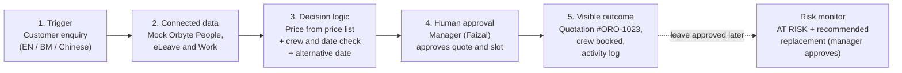

# ORO AI

> **"Don't just make promises. Keep them."**
> SDC Hackathon 2026 · Domain 2: Orbyte Smart SME Challenge (Less Busywork, Better Business)

**Demo Environment - Simulated Orbyte Data.** All companies, people, prices, leave records and jobs in this project are **synthetic**.
ORO AI is **not** connected to the real Orbyte system, WhatsApp or any payment service.

---

## What is ORO AI?

ORO AI helps a small service business turn a customer's WhatsApp-style enquiry into an accurate quotation.
It only promises an appointment date that the business's staff can actually deliver.

Our demo company is **CoolAir Services Sdn Bhd**, a fictional air-conditioning installer in Cheras, Kuala Lumpur.

### The problem (Domain 2)

Small service businesses usually quote by hand. Before promising a date, the salesperson should check:

- the price list
- which technicians are on approved leave (Orbyte eLeave)
- who is already assigned to other jobs (Orbyte Work)
- whether the crew has the right skills (Orbyte People), e.g. an installation needs a **senior** technician

These records live in different places, so mistakes happen. Quotes are slow, prices are wrong, technicians are double-booked, and customers get dates the business cannot keep.
Things also go wrong **after** a promise is made, for example when a technician takes emergency leave.

### Our solution

ORO AI reads the enquiry and works out the price from the approved price list.
It then checks real staff availability and recommends a safe date and crew.
A **manager approves** the result before anything is booked, and **every step is logged**.
If a technician's leave is approved later, ORO AI flags the affected job as **AT RISK** and recommends a replacement. The manager approves that too.

Prices and availability are calculated by plain, testable code, not by an AI model. The same input always gives the same answer.

---

## The 5-step automated journey



| Step | What happens in the demo |
|---|---|
| 1. Trigger | *"Boss, can you install 6 units of 1.5HP aircon at our Cheras office this Friday?"* |
| 2. Connected data | Ali is on leave Friday. Bala, Mei and Chong already have Friday jobs (simulated Orbyte records). |
| 3. Decision logic | 6 × RM190 = **RM1,140**. Friday is **not feasible**. **Monday 26 Oct** is feasible with Bala (senior) + Mei. |
| 4. Human approval | Manager Faizal clicks **Approve Quotation & Confirm Slot**. The server checks availability again before booking. |
| 5. Visible outcome | Quotation **#ORO-1023** is saved, the crew is reserved, and every action is in the activity log. A printable quotation is available. |

---

## Tech stack

| Part | Technology |
|---|---|
| Web app | React + Vite + Tailwind CSS (`artifacts/oro-ai`) |
| API server | Node.js 24 + Express 5 + TypeScript (`artifacts/api-server`) |
| Database | SQLite, using Node's built-in `node:sqlite` (4 tables: `staff`, `capacity_blocks`, `quotes`, `activity_log`) |
| API contract | OpenAPI (`lib/api-spec/openapi.yaml`), with generated React Query hooks and Zod validation |
| Orbyte integration | Mock adapters only. See [`orbyte-api-assumptions.md`](orbyte-api-assumptions.md) |
| Tests | Node's built-in test runner (`node --test`) |
| Package manager | pnpm workspaces (monorepo) |

### Where the important code is

| What | File |
|---|---|
| Enquiry reading (EN / BM / Chinese keywords) | `artifacts/api-server/src/lib/oro/parser.ts` |
| Price list | `artifacts/api-server/src/lib/oro/services.ts` |
| Crew rules, feasibility, alternative dates | `artifacts/api-server/src/lib/oro/scheduling.ts`, `availability.ts` |
| Manager approval and double-booking protection | `artifacts/api-server/src/lib/oro/approval.ts`, `quotes.ts` |
| Leave-change risk monitor and recovery | `artifacts/api-server/src/lib/oro/risk.ts` |
| Mock Orbyte adapters | `artifacts/api-server/src/lib/oro/orbyte-adapters.ts` |
| Synthetic demo data | `artifacts/api-server/src/lib/oro/seed.ts` |
| The web page | `artifacts/oro-ai/src/pages/workspace.tsx` |
| Automated tests | `artifacts/api-server/tests/` |

---

## Run it on Replit (recommended)

1. Open the project on Replit.
2. Click **Run**. This starts two services:
   - **API Server** (`artifacts/api-server`) on `/api`
   - **ORO AI web app** (`artifacts/oro-ai`) on `/`
3. Open the **Preview** pane and choose **ORO AI**.
4. The database is created and filled with synthetic data automatically on first start.
   It is stored at `artifacts/api-server/data/oro.db`, which Git ignores.

To share it with judges, use Replit's **Publish** button. Judges only need the published URL; they do not need to install anything.

### Demo script (about 3 minutes)

1. Click **Reset Demo State** (top right) to start clean.
2. Choose **Manager (Faizal)** in the header role switch.
3. Click the chip **Scenario 1: Flagship Friday Conflict (EN)**, then **Analyse Enquiry**.
   You will see RM1,140, a Friday conflict with reasons, and Monday offered as Option B.
4. Switch to **Sales Staff (Mei)**. The approve button locks with the badge "Requires Manager (Faizal) Approval". Switch back to Manager.
5. Click **Approve Quotation & Confirm Slot** on Monday, then **View Printable Quotation** → **Print / Save PDF**.
6. Click **Simulate Orbyte Event: Approve Bala's Emergency Leave (Mon, 26 Oct)**. A red **COMMITMENT AT RISK** card recommends **Chong**.
7. Click **Approve Recovery & Update Orbyte Work**. The crew becomes Chong + Mei, and the activity log records the swap.
8. Optional: try Scenarios 2-4 (Bahasa Melayu multi-service, Chinese enquiry, missing information).
   Click **Reset Demo State** before each one, because Scenario 1's booking uses up Monday's crew.

### Running outside Replit

You need Node.js 24 or newer and pnpm. Run `pnpm install`, then `npm test` to run the automated tests.
The web app expects the API at `/api` on the same address. Replit's router handles this.
If you run it elsewhere, you would need to add a reverse proxy that sends `/api` to the API server. This is not set up in this repository.

---

## Automated tests: `npm test`

From the project root, run:

```bash
npm test
```

(`pnpm test` works too.) The test runner:

1. builds a private test copy of the API server
2. starts it with its **own temporary database**, so your demo data is not touched and the app does not need to be running
3. runs the 10 required test cases from the hackathon brief against the real backend logic and the real SQLite database
4. prints PASS (✔) or FAIL (✖) for each test and exits with an error code if anything fails

| # | Test | What is checked |
|---|---|---|
| 1 | Correct quotation | 6 × 1.5HP installation = **RM1,140** |
| 2 | Different quantity | 4 × 1.5HP installation = **RM760** |
| 3 | Unavailable date | Friday 23 Oct 2026 is rejected: Ali on leave, Bala / Mei / Chong already assigned, with reasons |
| 4 | Available alternative | Monday 26 Oct 2026 recommended with **Bala + Mei**; weekends never suggested |
| 5 | Data changes | Changing leave or job records changes the answer (Friday becomes feasible; Monday's crew changes) |
| 6 | Missing details | *"Can you install aircon?"* asks for size, quantity, date and location; no price is guessed |
| 7 | Manager approval | The quote is saved as approved by Faizal, the crew is booked in the database, the action is in the activity log, and Sales staff get HTTP 403 |
| 8 | Double-booking prevention | Simultaneous confirmations cannot book the same technician twice; an infeasible date is refused at approval time |
| 9 | Manglish / BM | *"Boss, Friday boleh pasang 6 biji 1.5HP dekat Cheras?"* → 6 × 1.5HP install, Fri 23 Oct, Cheras |
| 10 | Leave-change detection + recovery | Bala's approved Monday leave flags the job **AT_RISK** and recommends **Chong**; only the manager can approve the swap |

Two extra checks also run: recovery skips a technician who is already booked, and preset scenarios 2 and 3 behave as expected.

---

## Safety and honesty notes

- All data is **synthetic**. Do not enter real customer personal data.
- Orbyte, eLeave, Work and approvals are **simulated** (see [`orbyte-api-assumptions.md`](orbyte-api-assumptions.md)).
- The role switch is a **demo control, not real login**.
- **Never commit secrets.** Do not commit `.env` files, API keys or passwords. Use Replit **Secrets** instead.
  `.gitignore` already excludes `.env` and `.env.*`.

## License

Licensed under the [Apache License 2.0](LICENSE).
Copyright 2026 the ORO AI team (SDC Hackathon 2026).
